# INSPIRAPP ✨

Una app móvil que armé para tener a mano las palabras de grandes mentes: filósofos, maestros espirituales, líderes y atletas. La idea es sencilla: que cada día recibas una frase que te mueva algo por dentro, y que si quieres ir un poco más profundo, puedas escuchar audios guiados para encontrar tu momento.

La hice pensando en que sea tranquila, oscura y con detalles dorados, como una vela encendida (de ahí el logo).

## 🎥 Video de demostración

▶️ **[Ver el video de demostración](https://drive.google.com/drive/folders/1XcYE49PTawJdq3Epn4dfsVw3MiKwJTQe?usp=sharing)**

## 📱 Cómo funciona

### 1. Entrar a la app

Al abrir la app te encuentras con el inicio de sesión. Puedes entrar con tu correo y contraseña, o con un solo toque usando tu cuenta de Google. Si todavía no tienes cuenta, hay una pantalla de registro donde pones tu nombre, tu correo y tu contraseña (con confirmación). El botón de Google es el mismo para crear cuenta o iniciar sesión.

| Iniciar sesión | Crear cuenta |
|:---:|:---:|
| 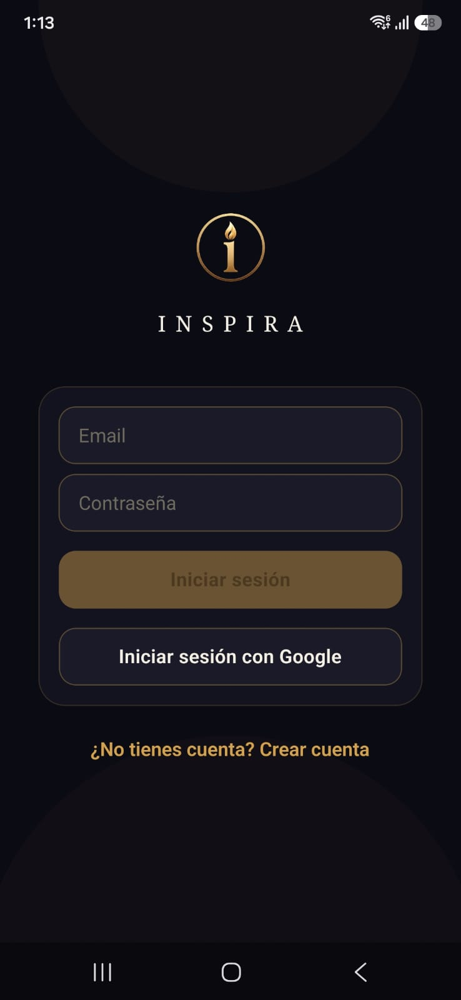 | 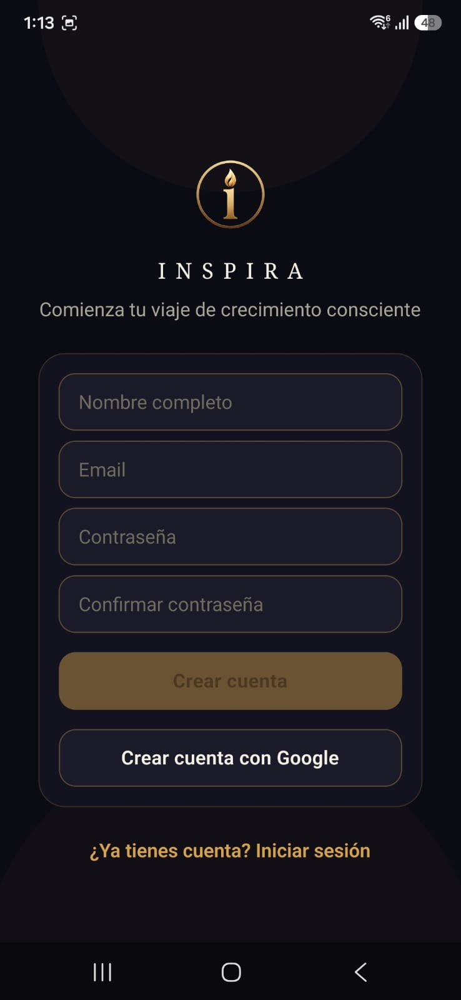 |

Si tocas el botón de Google, se abre el selector de cuentas del teléfono y eliges con cuál quieres entrar.

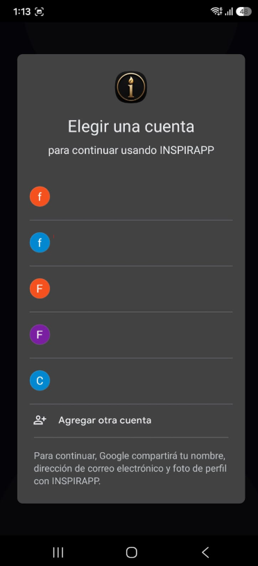

### 2. Onboarding: la app se adapta a ti

La primera vez que entras te hago tres preguntas rápidas para que lo que veas después sea realmente tuyo.

**Paso 1 – Categorías del alma.** Eliges qué áreas quieres nutrir: autoestima, filosofía, disciplina, religión, motivación, espiritualidad, amor, éxito, reflexión, vida, hábitos, budismo / zen. Hay que elegir al menos una.

**Paso 2 – Mentes maestras.** Eliges a quién quieres escuchar: Nietzsche, Jesús de Nazareth, Marco Aurelio, Muhammad Ali, Ilia Topuria, Frantry Lopez, Miyamoto Musashi, Khalil Gibran y más. También al menos una.

**Paso 3 – Tu hora diaria.** Escoges a qué hora quieres recibir tu recordatorio, con un selector de hora, minutos y a.m./p.m. Si prefieres no activarlo todavía, puedes saltarlo y hacerlo luego desde el menú.

| 1/3 Categorías | 2/3 Mentes maestras | 3/3 Hora diaria |
|:---:|:---:|:---:|
| 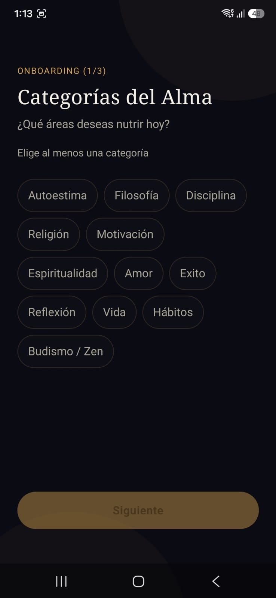 | 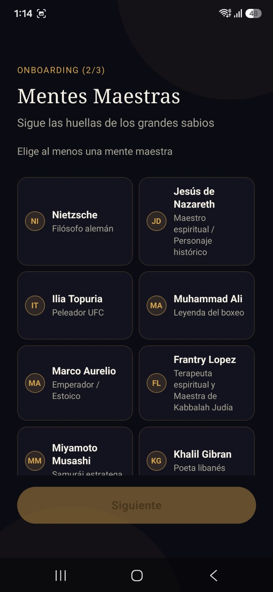 | 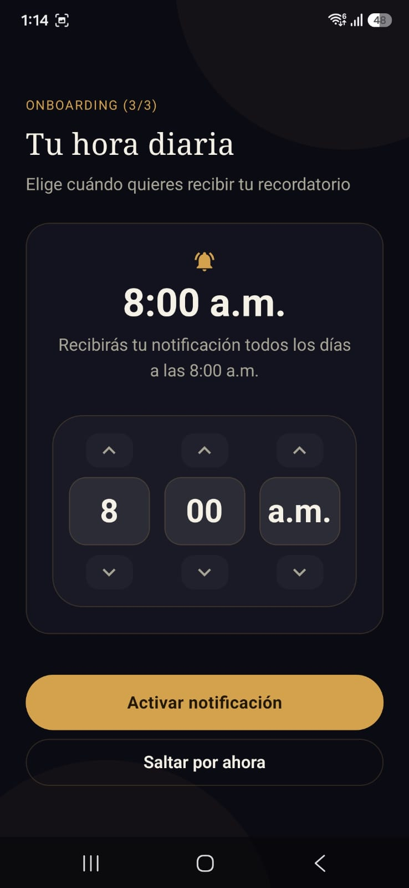 |

Al activar la notificación, Android te pide permiso. La app solo manda un recordatorio local al día, a la hora que tú elegiste, y nada más.

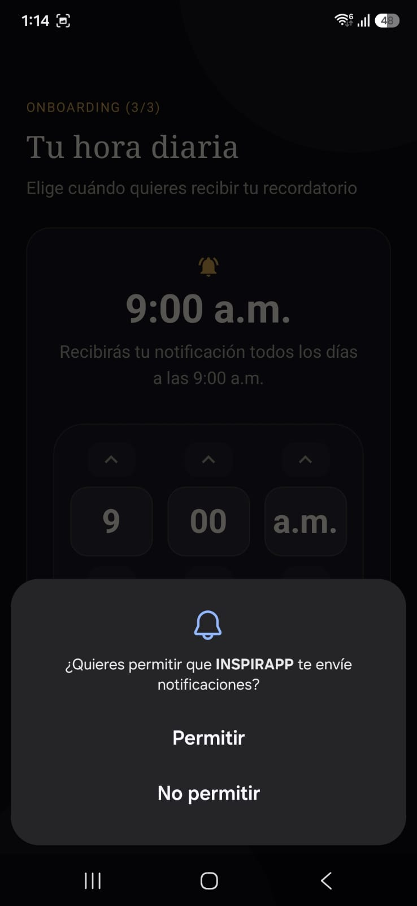

### 3. Pantalla principal

Aquí es donde vives el día a día. Te saludo por tu nombre y te muestro:

- **La frase del día**, en una tarjeta grande con tipografía serif, con su autor, quién es y las categorías a las que pertenece. Se elige según lo que marcaste en el onboarding.
- **Audio del día**: un audio recomendado para hoy.
- **Explora frases**: para navegar más frases.
- **Audio: encuentra tu momento**: la biblioteca completa de audios.

Arriba a la derecha está el menú, desde donde puedes cambiar tus **categorías**, tus **mentes maestras**, tu **hora de notificación** o **cerrar sesión**.

| Home | Menú |
|:---:|:---:|
| 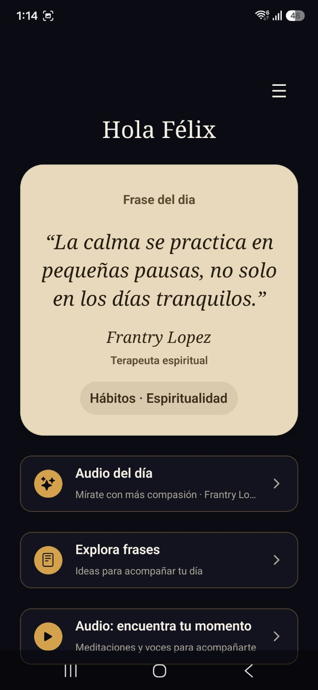 | 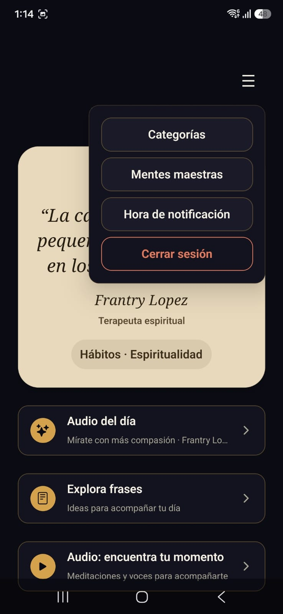 |

### 4. Frases

Cada frase ocupa una tarjeta grande para que la leas sin distracciones: la cita, quién la dijo, su rol (por ejemplo "Maestro espiritual") y sus categorías. Todas salen de lo que elegiste, así que no ves cosas que no te interesan.

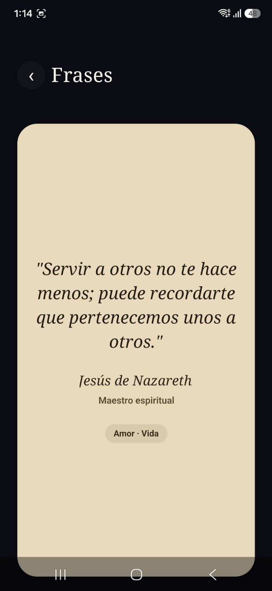

### 5. Audios

La biblioteca de audio está organizada por voz. Eliges una voz y ves sus audios; por ejemplo, de Frantry Lopez: _"Cuando sientas que ya no puedes"_, _"Mírate con más compasión"_ y _"No llegaste aquí por casualidad"_.

Al tocar uno se abre el reproductor, con la onda de audio, el título, la voz, la barra de progreso con el tiempo, y el botón de play/pausa.

| Biblioteca | Reproductor |
|:---:|:---:|
| 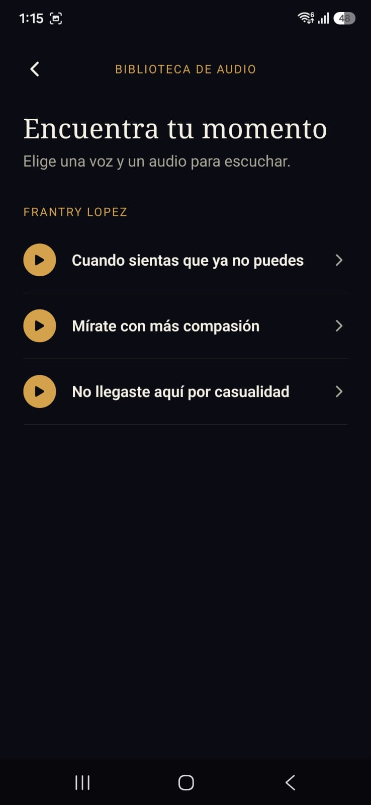 | 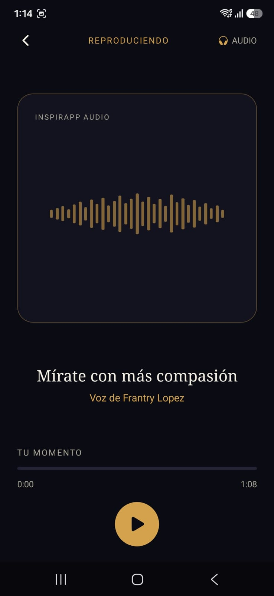 |

## 🛠️ Con qué la hice

| Qué | Con qué |
|---|---|
| App | Expo + React Native + TypeScript |
| Navegación | expo-router |
| Animaciones y gestos | Reanimated y Gesture Handler |
| Autenticación | Firebase Auth (correo + Google) |
| Base de datos y archivos | Supabase (Postgres + Storage) |
| Audio | expo-audio |
| Notificaciones | expo-notifications (recordatorio diario local) |
| Builds | EAS Build |

## 🗂️ Estructura del proyecto

> El código fuente vive en un repositorio privado. Aquí dejo la estructura para que se vea cómo está organizada.

```
INSPIRAPP
├── app/                          Pantallas (expo-router)
│   ├── _layout.tsx               Layout raíz y tema oscuro dorado
│   ├── (auth)/                   Acceso y onboarding
│   │   ├── index.tsx             Bienvenida
│   │   ├── login.tsx             Iniciar sesión
│   │   ├── register.tsx          Crear cuenta
│   │   ├── onboarding-categories.tsx
│   │   ├── onboarding-master-minds.tsx
│   │   └── onboarding-notification-time.tsx
│   └── (tabs)/                   App principal
│       ├── index.tsx             Home (frase y audio del día)
│       ├── phrases.tsx           Frases
│       ├── phrase/[phraseId].tsx Detalle de una frase
│       ├── audio.tsx             Biblioteca de audio
│       ├── audio-player.tsx      Reproductor
│       ├── categories.tsx        Editar categorías
│       ├── master-minds.tsx      Editar mentes maestras
│       └── notification-time.tsx Hora de la notificación
├── components/                   Componentes reutilizables (logo, textos, botón de Google…)
├── constants/                    Tema, categorías y mentes maestras
├── lib/
│   ├── firebase.ts               Autenticación
│   ├── supabase.ts               Cliente de base de datos
│   ├── user-profile.ts           Perfil y preferencias del usuario
│   ├── phrase-library.ts         Carga y filtrado de frases
│   ├── audio-library.ts          Audios y audio del día
│   └── notifications.ts          Permisos y recordatorio diario
├── supabase/                     Esquema, datos iniciales y políticas de storage
└── LOGOS/                        Icono, logo y splash
```

---

Hecha con cariño por Felix.
